<div align="center">
  <a href="research-project-report.docx.pdf">
    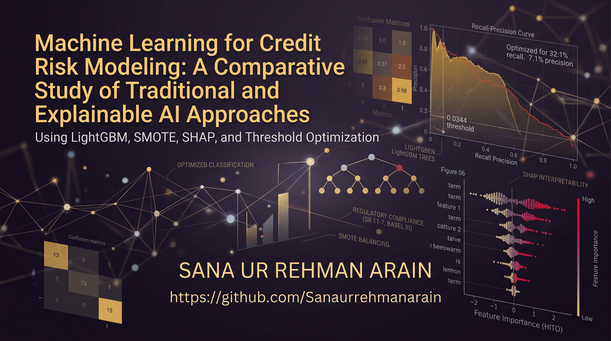
  </a>
  <p><em>Click the banner above to open the full thesis (PDF)</em></p>
</div>

<h1 align="center">Machine Learning for Credit Risk Modeling</h1>
<h3 align="center">A Comparative Study of Traditional & Explainable AI Approaches</h3>

<p align="center">
  
  
  
  
  
  
  
  
</p>

---

## Abstract

**Background.** Credit risk modeling — estimating a borrower's probability of default (PD) — is central to modern financial risk management. Traditional statistical models such as logistic regression remain the industry standard for their interpretability, but they struggle to capture non-linear relationships in borrower data, while modern gradient-boosting ensembles trade transparency for predictive power.

**Methods.** This thesis benchmarks Logistic Regression, Random Forest, XGBoost, and LightGBM on the **OpenIntro Loans Full Schema** dataset (10,000 loans, 55 raw variables). Class imbalance (1.8% default rate) is addressed with **SMOTE** oversampling applied strictly to the training fold. **SHAP (Shapley Additive Explanations)** is used to produce global and local model explanations, and a **False-Positive-Rate parity audit** evaluates the final model against Basel III, SR 11-7, and ECOA fair-lending expectations.

**Results.** After correcting for target leakage introduced by post-origination repayment fields (Section 4.1.2 of the thesis), **LightGBM** was selected as the production candidate. At a threshold-optimized operating point (≈3.4%), it achieves a Recall of **32.1%** and Precision of **7.1%** — roughly 4× better than random selection against a 1.8% base default rate — while Random Forest attains a marginally higher global AUC (0.670 vs. 0.659) but collapses to a trivial majority-class classifier at the standard 0.50 threshold. SHAP analysis identifies interest rate, loan grade, debt-to-income ratio, and income verification status as the dominant risk drivers. The fairness audit found no evidence of disparate impact against low-income borrowers on the FPR-parity metric (0.07% vs. 0.13% for high-income borrowers).

**Implications.** The study demonstrates that, when rigorously validated against target leakage and paired with SHAP-based explainability, ensemble ML models can satisfy both the predictive-accuracy expectations of risk managers and the transparency expectations of regulators — without requiring a return to purely linear scoring models.

**Keywords:** Credit Risk Modeling · Machine Learning · LightGBM · Explainable AI (XAI) · SHAP · SMOTE · Basel III · SR 11-7 · Fair Lending · Financial Engineering

---

## Table of Contents

- [Abstract](#abstract)
- [Table of Contents](#table-of-contents)
- [📌 Project Overview](#-project-overview)
- [🛠️ Key Technologies](#️-key-technologies)
- [📂 Repository Structure](#-repository-structure)
- [🔬 Methodology \& Pipeline](#-methodology--pipeline)
- [📓 Notebook Workflow](#-notebook-workflow)
- [📈 Key Results](#-key-results)
  - [Table 1 — Model Benchmark at Standard Threshold (p = 0.50)](#table-1--model-benchmark-at-standard-threshold-p--050)
  - [Table 2 — LightGBM, Optimized Operating Point](#table-2--lightgbm-optimized-operating-point)
  - [Feature Drivers (SHAP)](#feature-drivers-shap)
- [📊 Visualizations \& Output Gallery](#-visualizations--output-gallery)
  - [Interactive Dashboard (`app.py`)](#interactive-dashboard-apppy)
  - [Thesis at a Glance](#thesis-at-a-glance)
- [🎯 Discussion \& Limitations](#-discussion--limitations)
- [🚀 How to Run](#-how-to-run)
  - [Method A: Using Docker (Recommended)](#method-a-using-docker-recommended)
  - [Method B: Local Python Environment](#method-b-local-python-environment)
- [📚 Dataset](#-dataset)
- [⚖️ Copyright Notice \& License](#️-copyright-notice--license)
- [📖 Citation](#-citation)
  - [📝 Suggested Citation](#-suggested-citation)
  - [📚 BibTeX](#-bibtex)
  - [👤 Author](#-author)

---

## 📌 Project Overview

This repository contains the complete implementation framework for my Master's thesis in Financial Engineering. It builds an **at-origination, regulatory-aware credit scoring engine** on the OpenIntro Loans Full Schema dataset and asks a single question:

> *Can modern ensemble machine learning outperform traditional statistical credit scoring **without** sacrificing the explainability and fairness that regulators require?*

The project spans the full model-risk lifecycle expected under **SR 11-7**: data validation and leakage testing, imbalanced-data handling, model benchmarking, post-hoc explainability with SHAP, decision-threshold calibration, and a disparate-impact fairness audit — culminating in a fully documented, reproducible thesis.

---

## 🛠️ Key Technologies

| Category | Tools |
| --- | --- |
| **Language** | Python 3.13.5 |
| **Core Libraries** | Pandas, NumPy, Scikit-Learn 1.8, LightGBM 4.7, XGBoost, imbalanced-learn 0.11, SciPy 1.11 |
| **Class Imbalance** | Imbalanced-Learn (SMOTE) |
| **Interpretability** | SHAP (TreeExplainer — Shapley Additive Explanations) |
| **Visualization** | Matplotlib, Seaborn |
| **Compliance Frameworks** | Basel III, Federal Reserve SR 11-7, Equal Credit Opportunity Act (ECOA) |

---

## 📂 Repository Structure

```text
Project/
├── data/
│   ├── clean_data.csv
│   ├── loans_full_schema.csv
│   ├── model_results.csv
│   ├── synthetic_ecoa_stress_test_1000_rows.csv
│   ├── synthetic_ecoa_stress_test.csv
│   ├── table1_demographics.csv
│   ├── X_test.csv
│   ├── X_train_resampled.csv
│   ├── y_test.csv
│   └── y_train_resampled.csv
├── models/
│   ├── best_model_lightgbm.pkl
│   └── best_model_xgboost.pkl
├── notebooks-&-codes/
│   ├── 01_data_cleaning.ipynb
│   ├── 02_exploratory_data_analysis.ipynb
│   ├── 03_feature_engineering.ipynb
│   ├── 04_model_training.ipynb
│   ├── 05_explainability_analysis.ipynb
│   ├── 06_fairness_compliance.ipynb
│   ├── 07_final_report_visuals.ipynb
│   ├── 08_Threshold_Optimization.ipynb
│   ├── app.py
│   ├── Appendix-C-Code-Snippets.ipynb
│   ├── credit_risk_figures.ipynb
│   ├── SSD-architectural-diagram.py
│   ├── synthetic-dataset.ipynb
│   └── thesis_at_a_glance.py
├── planning/
│   ├── 01_Problem_Statement.pdf
│   ├── 02_Lit_Review_Comp_Analysis.pdf
│   ├── algorithm.txt
│   ├── Credit_Risk_Pipline_Flowchart.md
│   └── Model_Architecture_Pseudocode.md
├── plots/
│   ├── fig01.png … fig12.png
│   ├── sdd_solution_architecture.png
│   ├── trilemma.png
│   ├── xai_credit_scoring_comparison.png
│   ├──  all other figures which used in the research-project-report.docx
│   └── thesis_at_a_glance.svg
├── research-project-report.docx.pdf
├── solution-design-document-SSD.pdf
├── CITATION.cff
├── Dockerfile
├── infographic_ascii.txt
├── LISENCE
├── Presentation.pptx
├── Prensentation.pdf
├── requirements.txt
├── banner.png
├── TASKS.md
└── README.md
```

---

## 🔬 Methodology & Pipeline

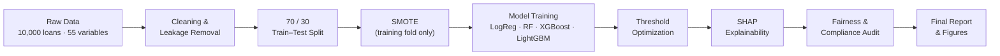

Two methodological safeguards are central to the credibility of the results:

- **Strict train/test isolation.** SMOTE is fit and applied exclusively to the training partition; the hold-out test set is never resampled, preserving an honest estimate of real-world class distribution during evaluation.
- **Target-leakage correction.** An early iteration of the model inadvertently included post-origination repayment fields (`paid_principal`, `paid_total`, `balance`, etc.), which inflated ROC AUC to an unrealistic 0.83 and Precision to 55.6%. A sensitivity analysis (Section 4.1.2 of the thesis) identified and removed these fields, yielding the conservative, methodologically honest **at-origination** results reported below (AUC ≈ 0.66).

---

## 📓 Notebook Workflow

| Phase | Notebook | Description |
| --- | --- | --- |
| **1. Processing** | `01_data_cleaning.ipynb` | Handles missing values and data types; constructs the binary target (`loan_status_binary`: 0 = Good, 1 = Default), grouping Current/Fully Paid vs. Late/Charged Off. |
| **2. Analysis** | `02_exploratory_data_analysis.ipynb` | Visualizes class imbalance, feature distributions, and risk drivers such as loan grade and interest rate across the portfolio. |
| **3. Engineering** | `03_feature_engineering.ipynb` | One-hot encodes categorical variables and addresses extreme class imbalance using **SMOTE** on the training set only. |
| **4. Modeling** | `04_model_training.ipynb` | Trains and evaluates Logistic Regression, Random Forest, XGBoost, and LightGBM using a static 70/30 hold-out split. |
| **5. XAI** | `05_explainability_analysis.ipynb` | Applies **SHAP TreeExplainer** to LightGBM for global and local (per-borrower) feature attribution. |
| **6. Auditing** | `06_fairness_compliance.ipynb` | Conducts a Disparate Impact / False-Positive-Rate parity analysis across income groups. |
| **7. Reporting** | `07_final_report_visuals.ipynb` | Compiles publication-quality figures, tables, and performance matrices for the final thesis document. |
| **8. Tuning** | `08_Threshold_Optimization.ipynb` | Calibrates the LightGBM decision threshold to balance precision and recall for a risk-averse operating point. |
| **9. Deployment** | `app.py` | Interactive Streamlit dashboard that reproduces the decision-threshold and SHAP explanations discussed in thesis Section 6.1, "Accuracy vs. Interpretability Trade-offs." |
| **10. Appendix** | `Appendix-C-Code-Snippets.ipynb` | Consolidated, ready-to-run code blocks referenced throughout Appendix C of the thesis. |
| **11. Robustness Check** | `synthetic-dataset.ipynb` | Generates a synthetic loan dataset used to stress-test the pipeline, as discussed in thesis Section 6.4, "Limitations." |
| **12. Summary Graphic** | `thesis_at_a_glance.py` | Generates `thesis_at_a_glance.svg`, the one-page infographic summarizing the study that appears at the end of the thesis. |

---

## 📈 Key Results

### Table 1 — Model Benchmark at Standard Threshold (p = 0.50)

| Model | ROC AUC | F1-Score | Recall | Precision |
| --- | ---: | ---: | ---: | ---: |
| **Random Forest** | **0.670** | 0.000 | 0.000 | 0.000 |
| LightGBM | 0.659 | 0.035 | 0.019 | 0.250 |
| XGBoost | 0.644 | 0.034 | 0.019 | 0.200 |
| Logistic Regression | 0.575 | 0.044 | 0.472 | 0.023 |

*At the default 0.50 threshold, Random Forest edges out LightGBM on global AUC — but it degenerates into a trivial "always predict non-default" classifier (Precision = Recall = 0), because the threshold is far too conservative for a 1.8% base rate. LightGBM retains baseline sensitivity to the minority class even before any tuning, which is why it was carried forward for threshold optimization rather than Random Forest.*

### Table 2 — LightGBM, Optimized Operating Point

*Dynamically lowering the decision threshold to **0.0344** shifts the model into a risk-averse posture designed to surface more true defaults for manual review.*

| Metric | Optimized Value | Operational Interpretation |
| --- | --- | --- |
| **Decision Threshold** | `0.0344` | Cut-off applied to the predicted default probability for flagging a loan. |
| **Recall** | `32.1%` | Approximately one in three future defaults in the test set is correctly flagged. |
| **Precision** | `7.1%` | ≈4× more accurate at isolating defaults than random selection against the 1.8% base rate. |
| **Fairness — FPR (Low Income)** | `0.07%` | No evidence of adverse bias against lower-income borrowers (vs. 0.13% for high-income). |

### Feature Drivers (SHAP)

Global SHAP attribution consistently ranks **interest rate**, **loan grade (particularly Grade D)**, **income verification status**, and **loan term** as the strongest predictors of default — directionally consistent with established credit-risk theory (Altman, 1968; Lessmann et al., 2015).

---

## 📊 Visualizations & Output Gallery

<div align="center">
  <table>
    <tr>
      <td align="center" width="33%">
        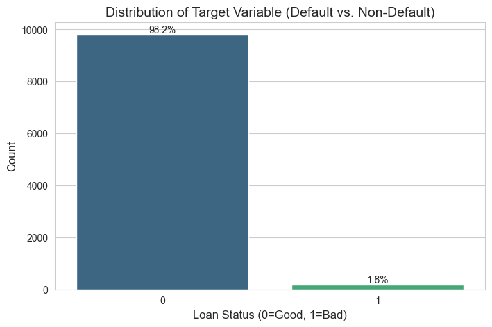
        <br><em><b>Fig 01 — Class Imbalance.</b> Distribution of the binary target variable: 98.2% Good Loans vs. 1.8% Defaults, illustrating the extreme imbalance that motivates the SMOTE resampling strategy.</em>
      </td>
      <td align="center" width="33%">
        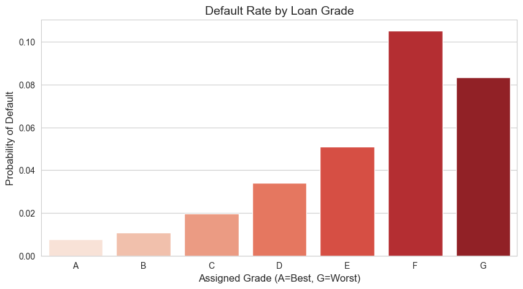
        <br><em><b>Fig 02 — Risk Ordering Sanity Check.</b> Default rate by lender-assigned loan grade (A = safest, G = riskiest). Default probability rises monotonically from under 1% (Grade A) to over 10% (Grade F), confirming the target variable behaves sensibly against an independent risk measure.</em>
      </td>
      <td align="center" width="33%">
        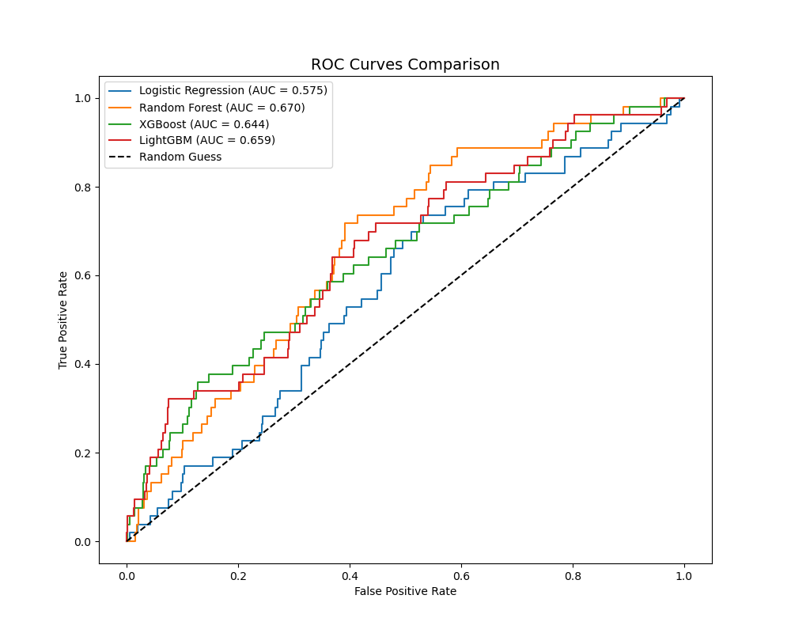
        <br><em><b>Fig 03 — Model Discrimination.</b> ROC curves for all four candidate models. Random Forest (AUC 0.670) and LightGBM (AUC 0.659) lead the ensembles; Logistic Regression (AUC 0.575) trails, reflecting its sensitivity to extreme outliers (e.g., DTI ratios up to 469).</em>
      </td>
    </tr>
    <tr>
      <td align="center">
        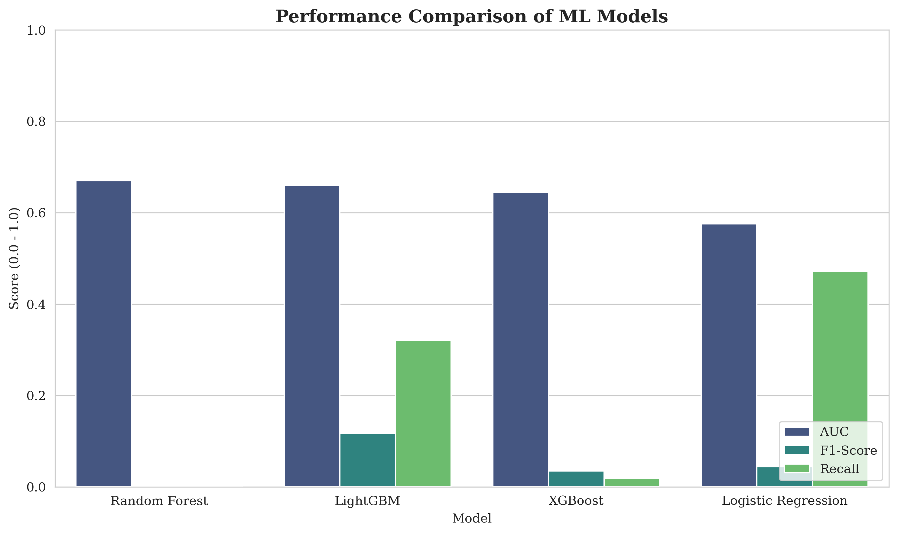
        <br><em><b>Fig 04 — Metric Comparison Across Models.</b> AUC, F1-Score, and Recall side by side. AUC bars are threshold-independent and directly comparable; the Recall/F1 bars reflect LightGBM's optimized ~3.4% threshold versus the other models' default 0.50 threshold, previewing — not proving — LightGBM's operational advantage.</em>
      </td>
      <td align="center">
        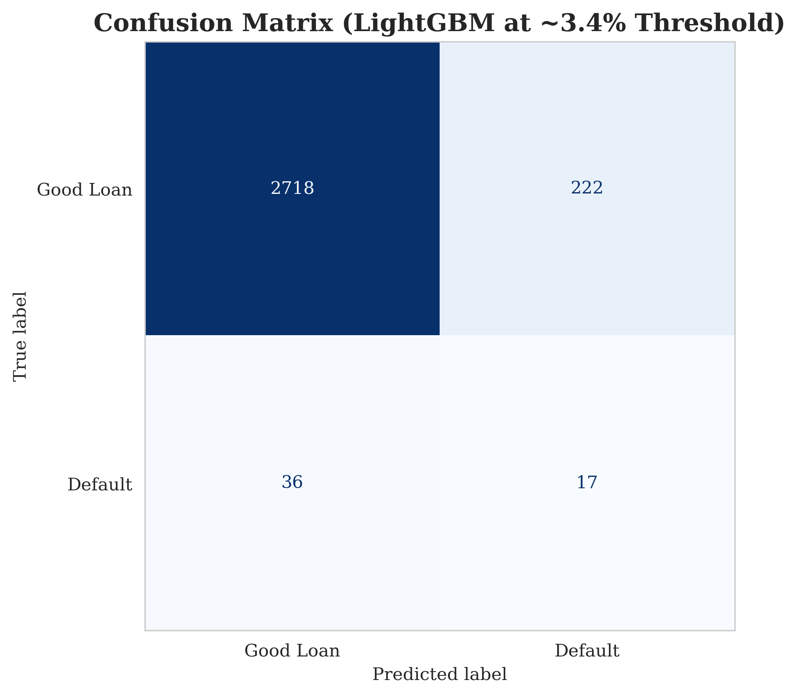
        <br><em><b>Fig 05 — LightGBM Confusion Matrix (≈3.4% threshold).</b> Of 2,993 hold-out loans, the model flags 239 as high-risk (222 false positives, 17 true positives) while missing 36 defaults, illustrating the conservative, review-focused operating point chosen for this study.</em>
      </td>
      <td align="center">
        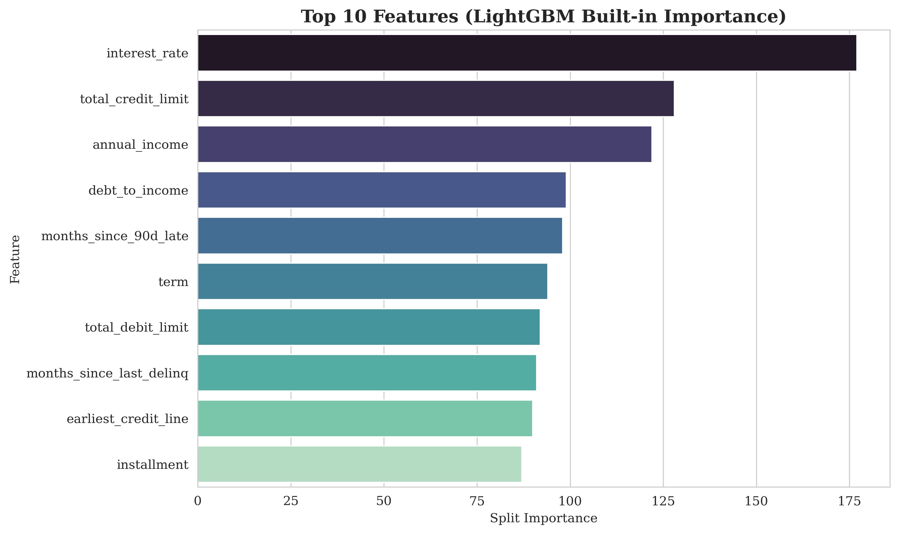
        <br><em><b>Fig 06 — Native Feature Importance.</b> Top 10 features by LightGBM's built-in split-frequency importance (not SHAP). Interest rate, credit limit, and annual income are split on most often — but this metric shows importance only, not the direction of effect, motivating the SHAP analysis in Fig. 07–09.</em>
      </td>
    </tr>
    <tr>
      <td align="center">
        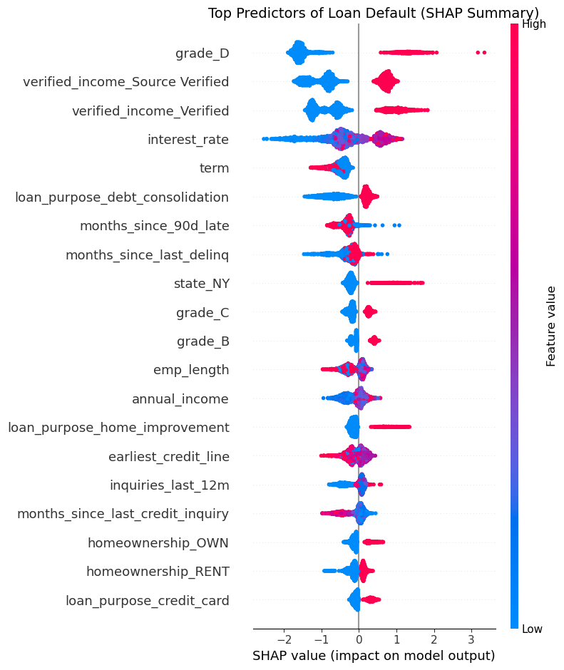
        <br><em><b>Fig 07 — SHAP Global Summary Plot.</b> Directional feature impact across the test set. Grade D, source-verified income, and 60-month terms (red = high feature value) push predictions toward higher default risk, giving the model's split importance (Fig. 06) an interpretable direction.</em>
      </td>
      <td align="center">
        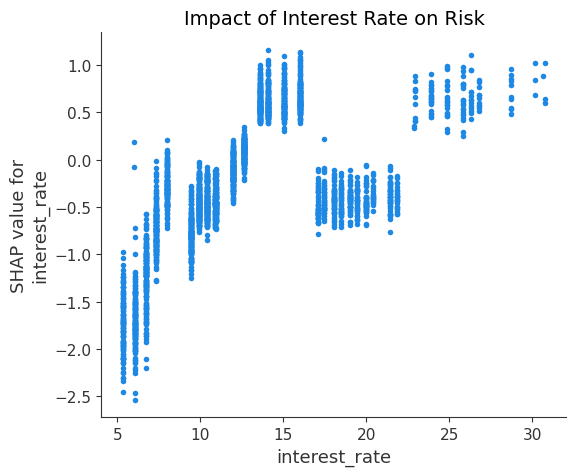
        <br><em><b>Fig 08 — SHAP Dependence Plot: Interest Rate.</b> The marginal relationship between interest rate and its SHAP contribution. Risk rises sharply between roughly 10–20% APR, then plateaus — indicating the model is most sensitive to rate changes in this mid-range band.</em>
      </td>
      <td align="center">
        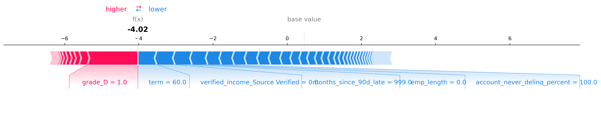
        <br><em><b>Fig 09 — Local SHAP Force Plot.</b> A per-borrower explanation ("adverse action" style) for an individual applicant: Grade D status pushes the log-odds score up, while a 60-month term and a clean delinquency history pull it back down, producing a final predicted default probability of ≈1.7%.</em>
      </td>
    </tr>
    <tr>
      <td align="center">
        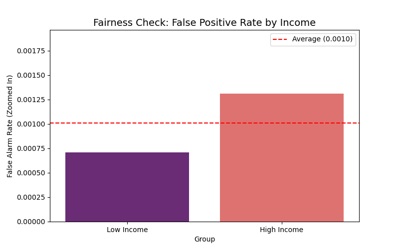
        <br><em><b>Fig 10 — Fair Lending Check.</b> False Positive Rate by income group. Low-income borrowers show a lower FPR (0.07%) than high-income borrowers (0.13%), providing no evidence of disparate impact under this proxy metric — though the small number of default events limits statistical power.</em>
      </td>
      <td align="center">
        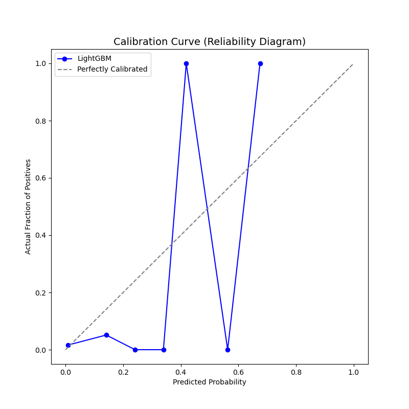
        <br><em><b>Fig 11 — Calibration (Reliability) Curve.</b> Predicted probability vs. observed default frequency for LightGBM. Calibration tracks the ideal diagonal reasonably well at lower, operationally relevant probability bins; upper bins are noisy due to the small absolute number of defaults in the test set.</em>
      </td>
      <td align="center">
        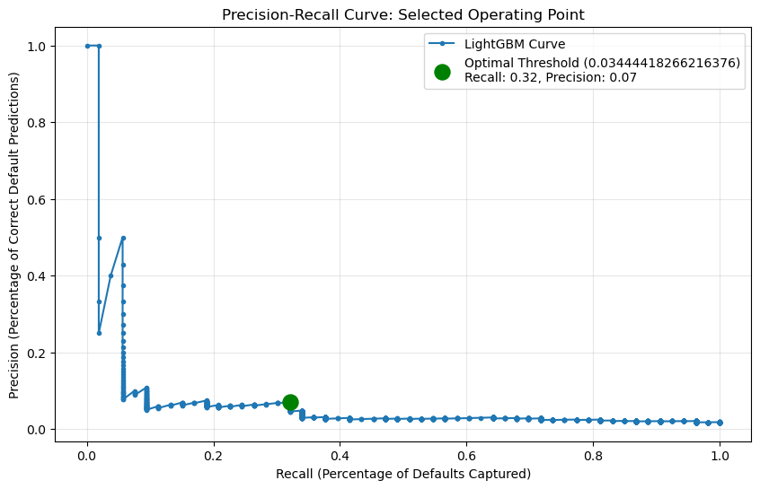
        <br><em><b>Fig 12 — Precision–Recall Curve.</b> The full precision–recall trade-off for LightGBM, with the selected operating point (threshold = 0.0344, Recall = 32.1%, Precision = 7.1%) marked, showing where the model sits along the broader trade-off curve.</em>
      </td>
    </tr>
  </table>
</div>

### Interactive Dashboard (`app.py`)

<div align="center">
  <table>
    <tr>
      <td align="center" width="50%">
        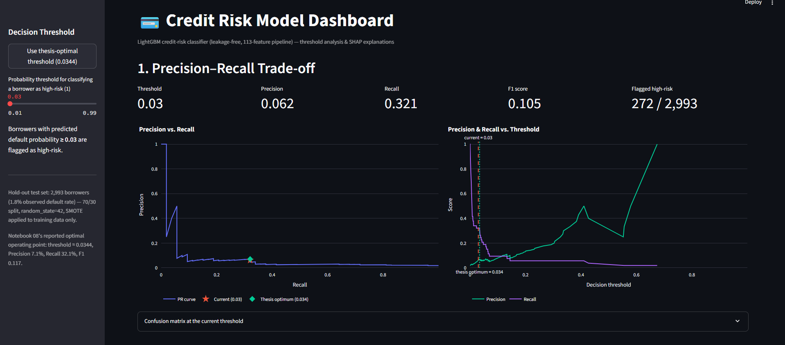
        <br><em><b>Dashboard 1 — Precision–Recall Trade-off.</b> Live view of precision and recall against the decision threshold, with the thesis-optimal cut-off (0.0344) marked alongside the current slider position.</em>
      </td>
      <td align="center" width="50%">
        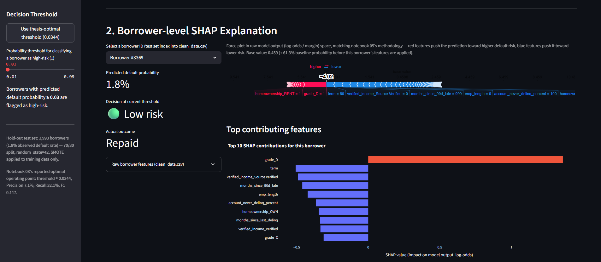
        <br><em><b>Dashboard 2 — Borrower-Level SHAP Explanation.</b> Force plot and top-10 SHAP contributions for an individual borrower, showing the adverse-action-style explanation the app generates on demand for any test-set applicant.</em>
      </td>
    </tr>
  </table>
</div>

### Thesis at a Glance

<div align="center">
  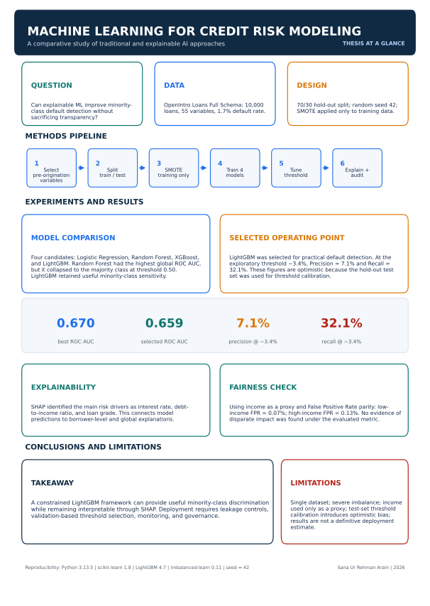
  <br><em><b>Thesis at a Glance.</b> One-page infographic (generated by <code>thesis_at_a_glance.py</code>) condensing the research question, leakage-safe pipeline, model comparison, SHAP drivers, fairness results, and headline takeaway into a single visual — reproduced at the end of the thesis document.</em>
</div>

---

## 🎯 Discussion & Limitations

**On accuracy vs. interpretability.** The results support the thesis's central claim: layering SHAP on top of LightGBM recovers a meaningful share of the transparency associated with linear models without discarding the predictive gains of gradient boosting. An honest, leakage-free AUC of 0.66 is modest by industry benchmarks, but it reflects a strictly at-origination feature set — a deliberate and regulator-aligned constraint, not a modeling shortfall.

**On precision–recall trade-offs.** The chosen operating point (Recall 32.1%, Precision 7.1%) intentionally favors *quality of rejection over quantity of rejection*: in high-volume consumer lending, the cost of a false positive (rejecting a good borrower) is often higher than the cost of a missed default, particularly once customer lifetime value is considered.

**Known limitations**, discussed in full in the thesis (Section 6.4):
- **Small sample size** (10,000 loans, 113 encoded predictors) relative to the number of features, increasing overfitting risk.
- **No demographic variables** (race, gender, age) in the OpenIntro dataset — the fairness audit uses income as a proxy and cannot constitute a full ECOA-grade disparate-impact audit.
- **Threshold selected on the test set** for demonstration purposes; a production deployment would require threshold calibration via cross-validation or a held-out validation set to avoid optimistic bias.
- **No statistical significance testing** (e.g., McNemar's test, bootstrapping) between model performance metrics.
- Binary classification only — Loss Given Default (LGD) and Expected Loss are left to future work.

**Future work** proposed in the thesis includes a two-stage architecture that layers a post-origination behavioral/early-warning model on top of the current at-origination PD model, and replacing SMOTE with algorithm-level cost-sensitive learning or focal loss to improve recall without synthetic-sample boundary blurring.

---

## 🚀 How to Run

You can run this project using **Docker** (recommended for exact reproducibility) or via a standard **local Python environment**.

### Method A: Using Docker (Recommended)

This project includes a `Dockerfile` that perfectly replicates the environment (Python 3.10, Scikit-Learn 1.3, LightGBM 4.7) used for this thesis, ensuring zero dependency conflicts.

**1. Build the Docker image**

Open your terminal in the project root and run:

```bash
docker build -t credit-risk-thesis .
```

**2. Run the Jupyter notebooks**

To explore the academic notebooks (01 through 08), launch the Jupyter Lab environment:

```bash
docker run -p 8888:8888 credit-risk-thesis
```

Look at your terminal output and click the `http://127.0.0.1:8888/lab?token=...` link to open Jupyter in your browser.

**3. Run the interactive dashboard**

To skip the code and interact directly with the live Streamlit dashboard (`app.py`), run:

```bash
docker run -p 8501:8501 credit-risk-thesis streamlit run notebooks/app.py
```

Open your browser and navigate to `http://localhost:8501`.

### Method B: Local Python Environment

**1. Install dependencies**

```bash
pip install -r requirements.txt
```

(Alternatively, install manually: `pip install pandas numpy scipy==1.11.0 scikit-learn==1.3.0 lightgbm==4.1.0 xgboost imbalanced-learn==0.11.0 shap seaborn matplotlib streamlit jupyterlab`)

**2. Run the notebooks in order**

Open Jupyter Lab and run the notebooks sequentially:

```text
01_data_cleaning.ipynb
02_exploratory_data_analysis.ipynb
03_feature_engineering.ipynb
04_model_training.ipynb
05_explainability_analysis.ipynb
06_fairness_compliance.ipynb
07_final_report_visuals.ipynb
08_Threshold_Optimization.ipynb
```

This reproduces the complete pipeline end to end: data cleaning → leakage-safe feature engineering → model training → SHAP explainability → fairness audit → publication-quality figures.

**3. Launch the interactive dashboard**

```bash
streamlit run notebooks/app.py
```

Reproduces the threshold-analysis and SHAP-explanation views shown in the [Interactive Dashboard](#interactive-dashboard-apppy) gallery above.

---

## 📚 Dataset

This project uses the **OpenIntro Loans Full Schema** dataset (derived from Lending Club data) for academic research purposes.

**Source:** https://www.openintro.org/data/index.php?data=loans_full_schema

---

## ⚖️ Copyright Notice & License

© 2026 Sana Ur Rehman Arain.

This project is licensed under the **MIT License**. You are free to use, copy, modify, merge, publish, distribute, sublicense, and sell copies of this project, in whole or in part, provided that the copyright notice and license text are included in all copies or substantial portions of the project.

**Proper citation and attribution are required.** If you use, adapt, or build upon this work, you must give appropriate credit to the original author, **Sana Ur Rehman Arain**, and include a link back to the original repository where possible.

This project is provided **"as is"**, without warranty of any kind, express or implied, including but not limited to the warranties of merchantability, fitness for a particular purpose, and noninfringement.

For questions or permission requests, contact: **sana.arain.work@gmail.com**

See the [LICENSE](LICENSE) file for the complete license terms.

Dataset provided by **OpenIntro**.

---

## 📖 Citation

If you use this project in academic research, publications, educational materials, or derivative works, please cite it and give appropriate credit to the original author.

> 💡 A [`CITATION.cff`](CITATION.cff) file is included, so GitHub shows a **"Cite this repository"** button in the sidebar with ready-made BibTeX, APA, and other formats.

### 📝 Suggested Citation

> Arain, S. U. R. (2026). *Machine Learning for Credit Risk Modeling: A Comparative Study of Traditional & Explainable AI Approaches* (Version 1.0) [Software]. https://github.com/sanaurrehmanarain/credit-risk-xai-framework

### 📚 BibTeX

```bibtex
@software{arain2026creditrisk,
  author  = {Arain, Sana Ur Rehman},
  title   = {Machine Learning for Credit Risk Modeling: A Comparative Study of Traditional & Explainable AI Approaches},
  year    = {2026},
  version = {1.0},
  url     = {https://github.com/sanaurrehmanarain/credit-risk-xai-framework}
}
```

### 👤 Author

<table>
  <tr>
    <td><b>Author</b></td>
    <td>Sana Ur Rehman Arain</td>
    <td rowspan="4" align="center" width="180">
      
    </td>
  </tr>
  <tr>
    <td><b>Role</b></td>
    <td>Data Scientist</td>
  </tr>
  <tr>
    <td><b>GitHub</b></td>
    <td><a href="https://github.com/sanaurrehmanarain">@sanaurrehmanarain</a></td>
  </tr>
  <tr>
    <td><b>Contact</b></td>
    <td><a href="mailto:sana.arain.work@gmail.com">sana.arain.work@gmail.com</a></td>
  </tr>
</table>

---

<p align="center"><em>⭐ If you found this repository helpful, consider giving it a star.</em></p>